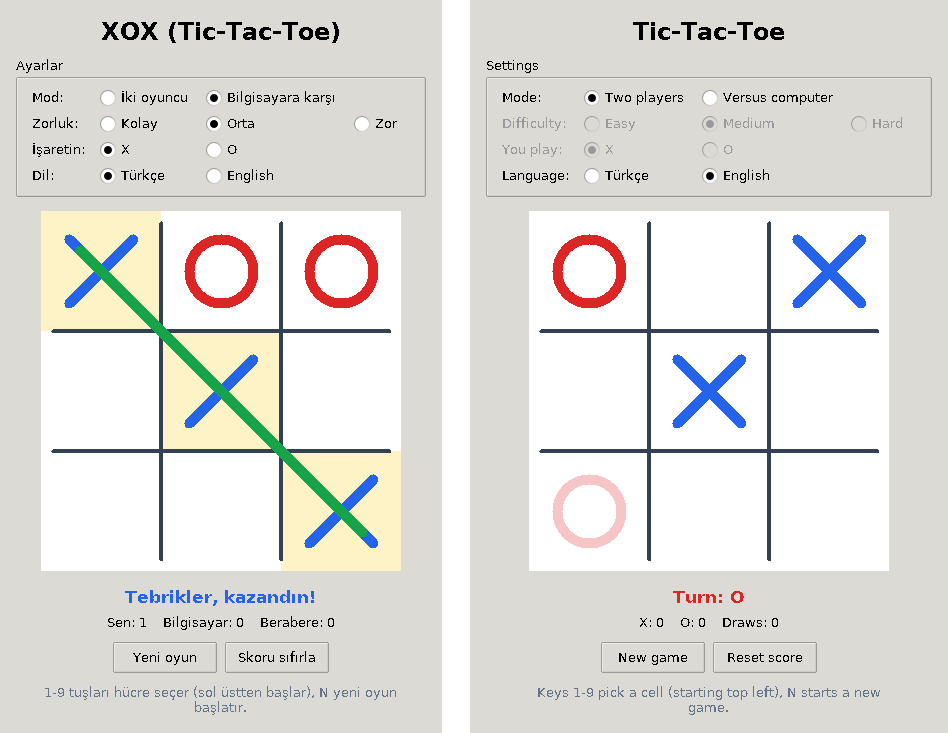

# XOX (Tic-Tac-Toe)

Python ve Tkinter ile yazılmış, pencereli bir XOX oyunu. İki kişi aynı bilgisayarda oynayabilir ya da üç zorluk seviyesi olan bilgisayara karşı oynayabilirsiniz. Ek paket gerektirmez.

A windowed Tic-Tac-Toe game written in Python with Tkinter. [English version below.](#english)



## Türkçe

### Özellikler

- Tıklanabilir 3x3 tahta; fare bir hücrenin üzerine geldiğinde hamlenin önizlemesi görünür
- İki oyuncu modu ve bilgisayara karşı mod
- Üç zorluk seviyesi:
  - **Kolay:** rastgele oynar
  - **Orta:** kazanabiliyorsa kazanır, rakip kazanmak üzereyse engeller, diğer durumlarda rastgele oynar
  - **Zor:** minimax algoritmasıyla kusursuz oynar ve hiç kaybetmez
- X ya da O olarak oynayabilme (O seçilirse ilk hamleyi bilgisayar yapar)
- Skor tablosu ve kazanan üçlünün vurgulanması
- Türkçe ve İngilizce arayüz
- Klavye kısayolları: `1`-`9` hücre seçer (sol üstten başlayarak), `N` yeni oyun başlatır

### Gereksinimler

- Python 3.9 veya üzeri
- Tkinter: Windows ve macOS'ta python.org kurulumuyla birlikte gelir. Ubuntu/Debian'da `sudo apt install python3-tk`, macOS'ta Homebrew Python kullanılıyorsa `brew install python-tk` ile kurulur.

### Çalıştırma

```bash
git clone https://github.com/millimusa/tic-tac-toe.git
cd tic-tac-toe
python tictactoe.py              # Türkçe arayüz
python tictactoe.py --lang en    # İngilizce arayüz
```

Bazı sistemlerde `python` yerine `python3` yazmak gerekir.

### Testler

```bash
python -m unittest -v
```

`test_game_logic.py`, Zor seviyedeki bilgisayarın hiçbir rakibe karşı kaybetmediğini olası bütün oyunları deneyerek doğrular. Arayüz testleri (`test_gui.py`) ekranı olmayan ortamlarda kendiliğinden atlanır.

### Proje yapısı

| Dosya | İçerik |
| --- | --- |
| `tictactoe.py` | Tkinter arayüzü ve programın giriş noktası |
| `game_logic.py` | Oyun kuralları ve bilgisayar rakibi (arayüzden bağımsız) |
| `test_game_logic.py` | Oyun kuralları ve bilgisayar rakibi için testler |
| `test_gui.py` | Arayüz testleri |

### Zor seviye nasıl çalışır?

Bilgisayar, minimax algoritmasıyla oyunun sonuna kadar olası bütün hamle dizilerini değerlendirir ve en iyi sonucu veren hamlelerden birini seçer. Erken gelen galibiyet daha yüksek puan aldığı için kazanabileceği durumda en kısa yoldan kazanır. Hesaplanan konumlar önbelleğe alındığından hamleler anında gelir.

## English

### Features

- Clickable 3x3 board with a preview of your move when the mouse is over a cell
- Two-player mode and a versus-computer mode
- Three difficulty levels:
  - **Easy:** plays randomly
  - **Medium:** wins when it can, blocks your winning move, otherwise plays randomly
  - **Hard:** perfect play with the minimax algorithm; it never loses
- Play as X or O (if you choose O, the computer moves first)
- Scoreboard and a highlighted winning line
- Turkish and English interface
- Keyboard shortcuts: `1`-`9` pick a cell (starting top left), `N` starts a new game

### Requirements

- Python 3.9 or newer
- Tkinter: included with the python.org installers for Windows and macOS. On Ubuntu/Debian install it with `sudo apt install python3-tk`; with Homebrew Python on macOS use `brew install python-tk`.

### Running the game

```bash
git clone https://github.com/millimusa/tic-tac-toe.git
cd tic-tac-toe
python tictactoe.py --lang en    # English interface
python tictactoe.py              # Turkish interface (default)
```

On some systems the command is `python3` instead of `python`.

### Tests

```bash
python -m unittest -v
```

`test_game_logic.py` checks every possible game to make sure the Hard computer never loses. The interface tests in `test_gui.py` are skipped automatically when no display is available.

### Project structure

| File | Contents |
| --- | --- |
| `tictactoe.py` | Tkinter interface and entry point |
| `game_logic.py` | Game rules and the computer opponent (no GUI code) |
| `test_game_logic.py` | Tests for the rules and the computer opponent |
| `test_gui.py` | Interface tests |

### How does the Hard level work?

The computer uses the minimax algorithm to look at every possible sequence of moves until the end of the game and picks one of the moves with the best result. Faster wins score higher, so it wins as quickly as possible when it can. Positions are cached, so the computer replies instantly.

## Lisans / License

MIT lisansı ile dağıtılır; ayrıntılar `LICENSE` dosyasındadır.
Released under the MIT License; see the `LICENSE` file.
